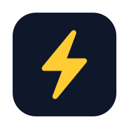

# Ledger

A personal task tracker in the style of Linear: native apps for Mac and iPhone that sync through a small self-hosted hub, with a JSON command line and an MCP server so an AI assistant can manage the same issues.

## What it does

- **Issues the Linear way**: six fixed statuses (Inbox, Todo, Today, Done, Canceled, Duplicate), priority, due dates, labels, projects, sub-issues, Markdown descriptions and `MOR-n` numbers.
- **Automatic two-week cycles**: the current and next cycle always exist, and unfinished work in an ended cycle rolls into the current one.
- **Recurring tasks**: completing a recurring issue creates the next occurrence with its due date advanced.
- **Keyboard-first Mac app**: sidebar (Inbox, Today, Cycle, Projects, saved views, labels), list and board layouts, an inspector for details, a ⌘K command palette and Linear's single-key shortcuts (C create, S status, P priority, L label, D due, J/K move, / search). Full-text search uses SQLite FTS5.
- **iPhone app**: tabs for Today, Inbox, Cycle, All and Projects, a detail sheet, and quick add that understands shorthand for due date, priority and labels.
- **Offline-first sync** across devices, and a one-time importer from a JSON export of Linear issues and cycles.

## How it works

```
 Mac app ─┐                                 ┌─ ledger CLI ── MCP server (Python)
iPhone app┴─ LedgerUI ── LedgerCore ── SQLite ┤
              (SwiftUI)   (engine)    (GRDB) └─ sync-serve (hub) ◄── HTTP ── other devices
```

- **`Core`** (`LedgerCore`) owns the schema, every write (one `put` path that stamps rows for sync), cycles, recurrence, search, the Linear importer, and both sides of sync.
- **`UI`** (`LedgerUI`) holds the SwiftUI screens and the observable model shared by the Mac and iPhone apps.
- **`CLI`** is the `ledger` command. It prints JSON, offers read-only `sql` and `schema` for ad-hoc questions, and runs the hub (`ledger sync-serve`).
- **`App`** is an XcodeGen project with the macOS and iOS app targets.
- **`mcp`** is a dependency-free Python MCP server with 9 tools that shells out to the CLI, so the assistant and the command line behave identically.

Every device keeps its own SQLite copy. Sync is row-level last-writer-wins: each write bumps a Lamport clock and marks the row dirty; `sync` pushes dirty rows to the hub and pulls everything newer than its cursor. The hub orders rows globally and is the only place issue numbers are assigned, so two devices never produce the same `MOR-n`. Deletes are tombstones. The hub listens on 127.0.0.1 with a bearer token per device and is meant to sit behind Tailscale. The full design is in [docs/design.md](docs/design.md).

## Tech stack

Swift 6 (Swift Package Manager, Swift Testing), SwiftUI, GRDB/SQLite with FTS5, swift-argument-parser, XcodeGen; Python 3 standard library for the MCP server; launchd for the hub and its nightly backup.

## Getting started

Requirements: macOS 15+, Xcode 16+ (Swift 6 toolchain), [XcodeGen](https://github.com/yonaskolb/XcodeGen) for the app targets, Python 3 for the MCP server. iPhone builds target iOS 18.

```bash
cp .env.example .env    # optional: DEVELOPMENT_TEAM for device builds, LEDGER_HUB_* to bake a default hub into the apps
```

`.env` is read only by `scripts/generate-project.sh`; runtime variables such as `LEDGER_DB` and `LEDGER_DEVICE` are described in [.env.example](.env.example).

**Command line, with a scratch database**

```bash
swift build --package-path CLI -c release
export LEDGER_DB=/tmp/ledger-demo.sqlite
CLI/.build/release/ledger label put Home --color '#6fd3a0'
CLI/.build/release/ledger issue create --title "Repot the fern" --status today --priority high --label home
CLI/.build/release/ledger summary
```

**Mac app**

```bash
scripts/build-mac.sh        # generates App/Ledger.xcodeproj and builds into App/build.noindex
open -n --env LEDGER_DB=/tmp/ledger-demo.sqlite App/build.noindex/Build/Products/Debug/Ledger.app
```

Without `LEDGER_DB` the apps and CLI use `~/Library/Application Support/Ledger/ledger.sqlite`. A `LEDGER_DB` database never syncs from the apps unless `LEDGER_SYNC=1`.

**iPhone app**: run `scripts/generate-project.sh`, open `App/Ledger.xcodeproj` and run the `LedgeriOS` scheme (set `DEVELOPMENT_TEAM` in `.env` for a device).

**MCP server**: link the CLI onto your PATH (or set `LEDGER_BIN`) and add it to Claude Code:

```bash
ln -s "$PWD/CLI/.build/release/ledger" ~/.local/bin/ledger
claude mcp add ledger -- python3 "$PWD/mcp/ledger_mcp.py"
```

**Sync hub**: see [docs/hub.md](docs/hub.md) for running `ledger sync-serve` under launchd, issuing device tokens, the Tailscale front door, nightly backups and connecting devices with `ledger sync-setup`.

## Tests

```bash
swift test --package-path Core     # 17 tests: issue operations, sync and conflict rules, hub numbering, cycles, recurrence, Linear import
swift test --package-path UI       # 28 tests: filters, grouping, command palette, quick-add parsing, sync settings, the model
swift test --package-path CLI      # 13 tests: commands end to end, including a live hub over HTTP
swift build --package-path CLI -c release && python3 -m unittest discover -s mcp   # 3 tests: MCP protocol and tools
```

The MCP tests drive the real release binary, so build it first; they skip otherwise.

## Project layout

```
Core/      LedgerCore: schema, writes, cycles, search, Linear import, sync client and hub
UI/        LedgerUI: SwiftUI screens and model shared by Mac and iPhone
CLI/       the ledger command and the sync hub server
App/       XcodeGen project: macOS and iOS apps
mcp/       MCP server wrapping the CLI, and its tests
scripts/   build, project generation, hub and backup launchd jobs
docs/      design.md (data model, sync, operations) and hub.md (running the hub)
```

`CLAUDE.md` holds the working notes used when developing with Claude Code.

## License

See [LICENSE](LICENSE).
